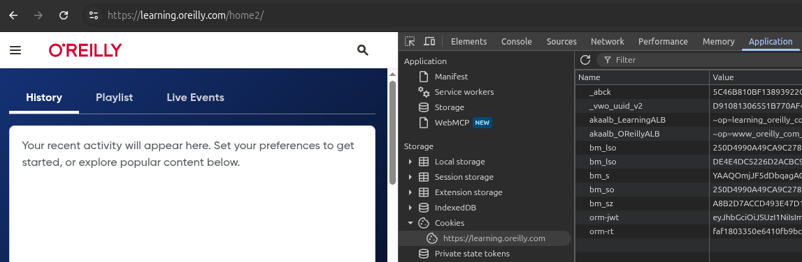

# DonReilly

Don Reilly is a Python script that lets you download O'Reilly books as EPUB files

## Create a Python virtual environment

```bash
python3 -m venv donreilly
source donreilly/bin/activate
```

## Install the dependencies

```bash
pip install aiohttp lxml
```

## Get your orm-jwt

1.- Open [O'Reilly Learning](https://learning.oreilly.com/) in your browser

2.- Open DevTools and go to the Cookies section

3.- Search for the orm-jwt cookie



4.- Then copy the orm-jwt token

## Download your book

```bash
python3 donreilly.py <book-id> --jwt '<orm-jwt-token>'
```

## Massive download

1.- Copy `books.example.json` to `books.json`

2.- Put your orm-jwt and the book ids in `books.json`

3.- Run it

```bash
python3 donreilly_massive.py
```

### Why do my downloads take so long?

Every 10 pages the download pauses for 30 seconds to avoid O'Reilly's rate limit. It continues by itself.
